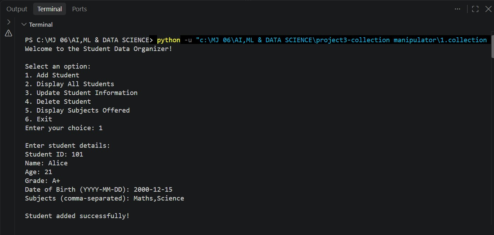
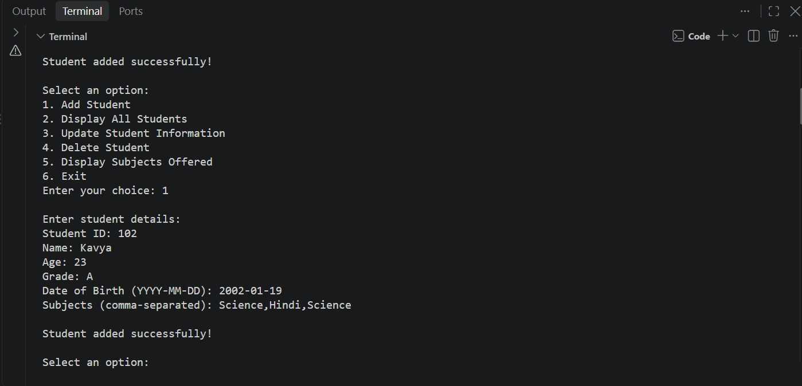
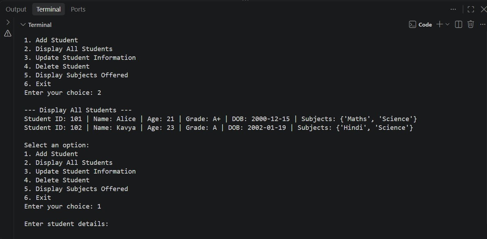
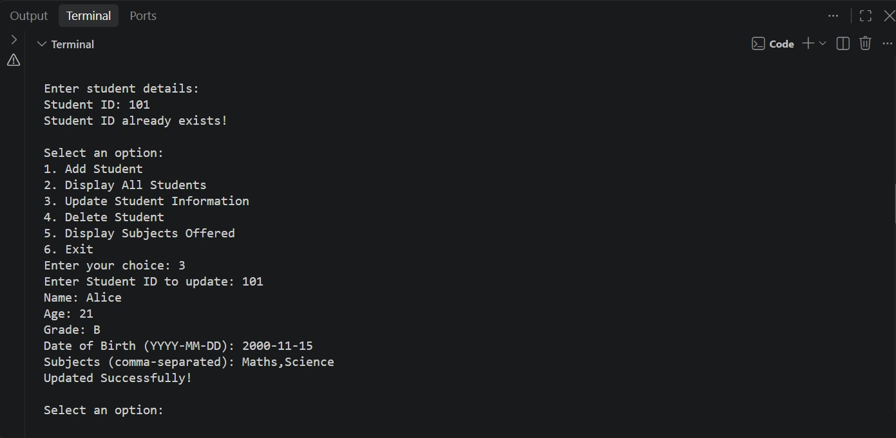
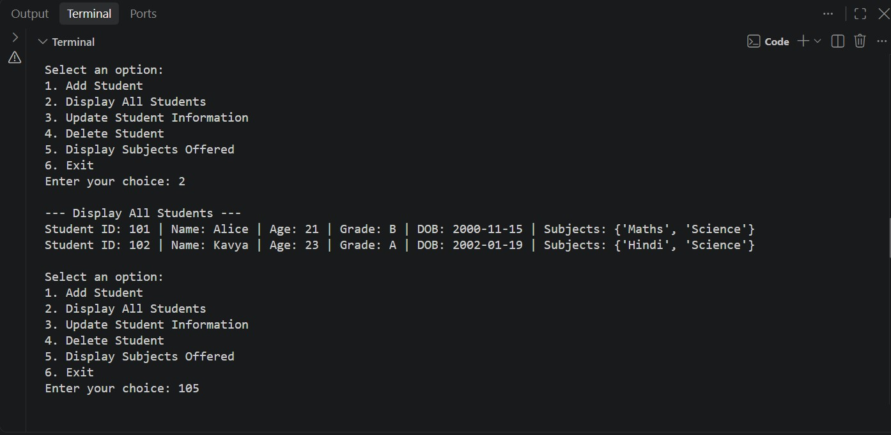
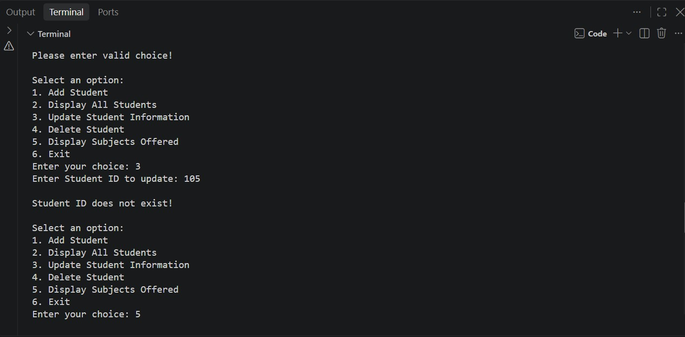
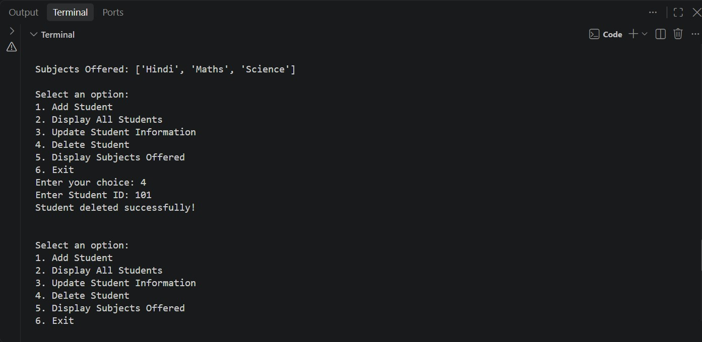
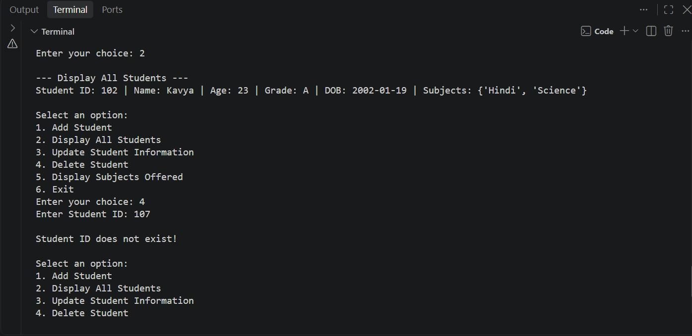
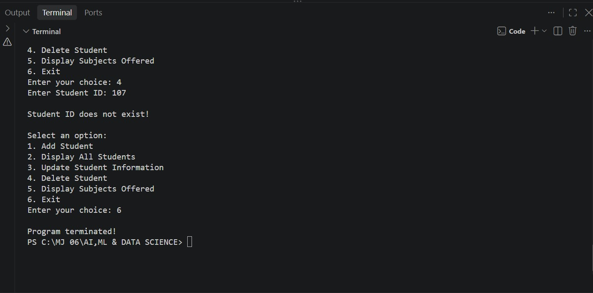

# Student Data Organizer

## Description
The Student Data Organizer is a Python-based console application used to manage student information. It allows users to add, display, update, and delete student records and search for students by subject.

## Features
- Add Student
- Display All Students
- Update Student Information
- Delete Student
- Display Subjects Offered
- Exit the Program

## Technologies Used
- Python 3.10+
- Match-Case Statement
- Lists
- Dictionaries
- Sets
- Tuples
- Loops and Conditional Statements

## Student Information
The program stores the following details:
- Student ID
- Student Name
- Student Age
- Student Grade
- Student Date of Birth
- Student Subjects

## Output

